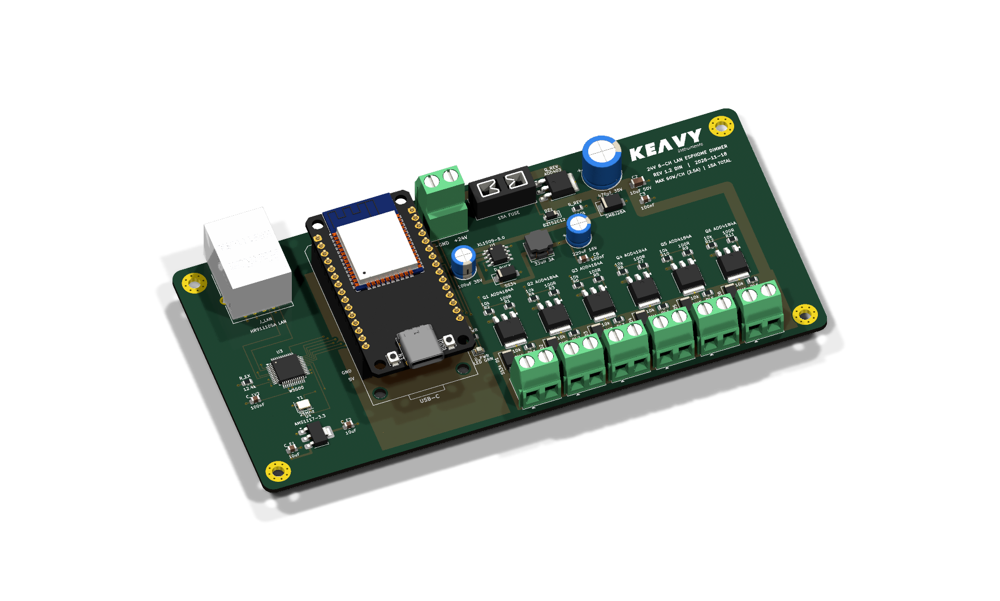
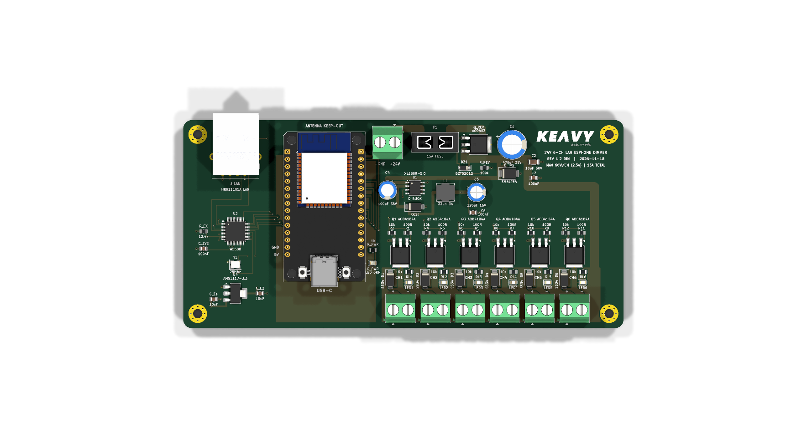

# 24V DC 6-Channel LAN ESPHome LED Dimmer (REV 1.2 DIN)

An open-source, DIN-rail friendly, high-power 24V DC 6-channel LED dimmer designed for **ESPHome** and **Home Assistant**. Engineered as a high-capacity, modular alternative to the **IKEA SILVERGLANS / TRÅDFRI** drivers, powered by an external 24V DC power supply.




---

## Key Features

- **6 Independent High-Power Channels**:
  - **48W – 60W per channel** (`2.0A – 2.5A` continuous @ 24V).
  - Up to **15A / 360W total continuous capacity**.
  - High-efficiency **AOD4184A** N-Channel logic-level MOSFETs in TO-252 (DPAK) with ultra-low $R_{DS(on)} < 9.5\text{ m}\Omega$ (~59 mW dissipation per channel @ 2.5A, cool running without external heat sinks).
- **Smooth Natural Dimming (IKEA SILVERGLANS Behavior)**:
  - Hardware LEDC PWM at **19.531 kHz** (ultrasonic, camera flicker-free, zero audible coil whine).
  - True gamma correction curve ($\gamma = 2.8$) for natural low-light perception.
  - Smooth default soft-transition on/off (600ms).
- **Modular ESP32 Controller**:
  - Socketed via two `1x15` 2.54mm female headers for standard **ESP32 DevKit V1 30-Pin (USB-C)**.
  - Easily swappable in seconds without desoldering.
  - Onboard USB-C on the dev board remains accessible on the bottom edge for programming/debugging.
- **Wired Ethernet LAN Connectivity**:
  - Onboard **WIZnet W5500** SPI TCP/IP controller + **HanRun HR911105A** RJ45 MagJack with internal magnetics and status LEDs.
  - Dedicated **AMS1117-3.3** LDO regulator for the Ethernet subsystem to ensure noise-free Wi-Fi/LAN operation.
- **DIN-Rail Friendly Form Factor**:
  - Dimensions: **152.0 mm × 72.0 mm** (fits standard **UM72** DIN-rail profile carriers).
  - 4x M3 mounting holes (3.2 mm diameter).
  - **Top-Facing Ports**: RJ45 Ethernet (`J_LAN`) and 24V DC Power Input (`J1`).
  - **Bottom-Facing Ports**: 6x 2-pin Screw Terminals (`CH1`–`CH6`) and USB-C port.
  - Left and right edges are 100% free of protruding connectors, allowing tight side-by-side DIN-rail packing.
- **Industrial-Grade Protection**:
  - Reverse Polarity Protection via high-current P-Channel MOSFET (**AOD403**) + 12V Zener gate clamp (**BZT52C12**).
  - **15A Mini Automotive Blade Fuse** (`F1`) with Keystone 3568 holder.
  - **SMBJ28A** TVS diode for clamping high-voltage inductive switching spikes.
  - 6x **SS34** 3A 40V Schottky flyback diodes across each channel output.
  - High-capacitance bulk filtering: Low-ESR 470µF 35V electrolytic + 10µF MLCC + 100nF decoupling.
- **Onboard Power Step-Down**:
  - **XL1509-5.0** 2A buck converter stepping 24V down to 5V to power the ESP32 dev board and the Ethernet 3.3V LDO.
- **Clear Silkscreen & Indonesian Market Component Availability**:
  - Bold `+` and `-` polarity indicators printed directly in front of each terminal block on both Top (`F.SilkS`) and Bottom (`B.SilkS`) layers.
  - All parts selected from common components readily available in Indonesia (Tokopedia / Shopee).

---

## Hardware Architecture & Pinout

### ESP32 Socket (`U2`, 30-Pin DevKit V1) Pinout

| ESP32 Pin | Socket Pad | Signal Name | Target | Function |
|---|---|---|---|---|
| **GPIO32** | Pad 6 | `ETH_RST` | W5500 Pin 37 (`RSTn`) | Ethernet Hardware Reset |
| **GPIO33** | Pad 7 | `ETH_INT` | W5500 Pin 36 (`INTn`) | Ethernet Interrupt |
| **GPIO25** | Pad 8 | `ETH_MISO` | W5500 Pin 34 (`MISO`) | SPI Master In Slave Out |
| **GPIO26** | Pad 9 | `ETH_MOSI` | W5500 Pin 35 (`MOSI`) | SPI Master Out Slave In |
| **GPIO27** | Pad 10 | `ETH_CS` | W5500 Pin 33 (`SCSn`) | SPI Chip Select |
| **GPIO14** | Pad 11 | `ETH_CLK` | W5500 Pin 32 (`SCLK`) | SPI Clock (20 MHz) |
| **GPIO16** | Pad 21 | `PWM_CH1` | Gate Q1 (`AOD4184A`) | Dimmer Channel 1 Output |
| **GPIO17** | Pad 22 | `PWM_CH2` | Gate Q2 (`AOD4184A`) | Dimmer Channel 2 Output |
| **GPIO18** | Pad 24 | `PWM_CH3` | Gate Q3 (`AOD4184A`) | Dimmer Channel 3 Output |
| **GPIO19** | Pad 25 | `PWM_CH4` | Gate Q4 (`AOD4184A`) | Dimmer Channel 4 Output |
| **GPIO21** | Pad 26 | `PWM_CH5` | Gate Q5 (`AOD4184A`) | Dimmer Channel 5 Output |
| **GPIO22** | Pad 29 | `PWM_CH6` | Gate Q6 (`AOD4184A`) | Dimmer Channel 6 Output |
| **5V / VIN**| Pad 15 | `+5V` | XL1509 Output / AMS1117 Input | Logic 5V Supply Rail |
| **GND** | Pad 14, 17 | `GND` | Ground Plane | System Common Ground |

---

## ESPHome Firmware Setup

The firmware configuration is located in [`firmware/dimmer_6ch.yaml`](firmware/dimmer_6ch.yaml).

### Compile & Flash
```bash
# Via USB-C (first-time flash)
esphome run firmware/dimmer_6ch.yaml

# Subsequent updates can be performed over Ethernet (OTA)
esphome run firmware/dimmer_6ch.yaml
```

Once flashed, 6 individual light entities (`light.dimmer_ch1` through `light.dimmer_ch6`) will automatically discover in Home Assistant with complete brightness control, soft on/off fading, and status persistence.

---

## Manufacturing & Assembly

Ready-to-order manufacturing files are included in the repository:
- **Gerber & Drill Files**: [`manufacturing/gerbers/`](manufacturing/gerbers/) (standard RS-274X and Excellon format, JLCPCB / PCBWay compatible).
- **Bill of Materials (BOM)**: [`manufacturing/BOM.csv`](manufacturing/BOM.csv).
- **Pick & Place (CPL)**: [`manufacturing/dimmer_6ch_cpl.csv`](manufacturing/dimmer_6ch_cpl.csv).
- **KiCad Project Files**: [`dimmer_6ch.kicad_pro`](dimmer_6ch.kicad_pro), [`dimmer_6ch.kicad_pcb`](dimmer_6ch.kicad_pcb).
- **DRC Verification**: 0 electrical violations, 0 unconnected items ([`drc_report.json`](drc_report.json)).

---

## License
Open-source hardware licensed under the CERN-OHL-P v2 (or MIT for accompanying software/firmware).
